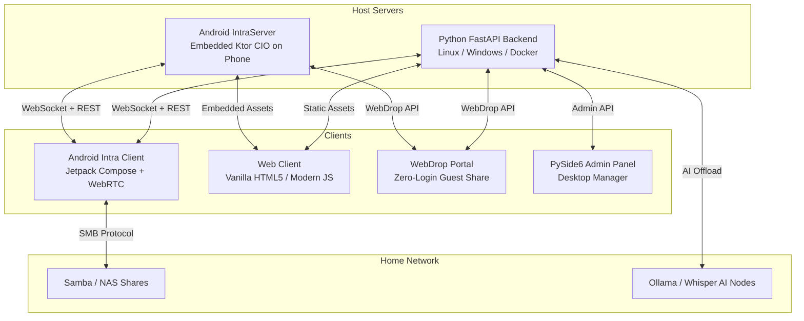

<div align="center">

# ⚡ Intra — The Autonomous LAN Super-App Ecosystem
**Private Messaging • Phone-Hosted Server • Zero-Friction WebDrop • Offline AI • SMB & IPTV**

[](https://fastapi.tiangolo.com/)
[](https://ktor.io/)
[](https://developer.android.com/jetpack/compose)
[](https://webrtc.org/)
[](LICENSE)

---


---

</div>

## 📖 What is Intra?

**Intra** is a privacy-first, zero-telemetry **Local Area Network (LAN) communications & home media ecosystem**. Designed to operate 100% offline without internet reliance, Intra turns your existing Wi-Fi router, PC, or even a spare Android phone into a high-speed communications hub for homes, dorms, off-grid expeditions, and emergency scenarios.

---

## 🌟 Key Feature Pillars

### 1. 💬 Encrypted & Fast LAN Messaging
* **Real-Time Communication:** Sub-millisecond messaging via persistent WebSockets.
* **P2P Audio & Video Calling:** Pure LAN WebRTC calling with low latency and zero data consumption.
* **Media Sharing:** High-speed streaming file transfer for photos, videos, and documents.
* **Modern UI:** Built from the ground up with Jetpack Compose (Material You 3, Dark/Light modes, adaptive status bars).
* **Apps Hub:** Quick-access animated sliding hub in the top bar for TV, SMB, Smart Home, and WebDrop.

### 2. 📱 Phone-as-a-Server (`:intra_server`)
* **No PC Required:** Any Android device (Android 5.0+) can host the entire Intra network server via native embedded **Ktor (CIO Engine)**.
* **Foreground Appliance Mode:** Runs 24/7 with `PARTIAL_WAKE_LOCK` and `WifiLock`, featuring a live hacker-appliance dashboard with real-time logs, IP badges, and QR pairing.
* **Embedded Web Client:** Serves the full web client directly from phone assets so laptops and iPhones can connect immediately.

### 3. 🚀 Zero-Friction WebDrop (`/drop`)
* **Instant Guest Sharing:** Share files and text across PCs, iPhones, and Androids without downloading any app or creating an account!
* **Drag-and-Drop Transfer:** React-grade dark glassmorphic interface with real-time multi-file streaming.
* **LAN Clipboard:** Share text snippets, Wi-Fi passwords, and links with 1-click copy.
* **Storage Safety Guard:** Automated 10-day retention cleanup prevents host storage bloat.
* **Host Phone QR Modal:** Open the WebDrop QR code right from your personal phone's Apps Hub to show guests—no need to touch the router server!

### 4. 🤖 Lumir AI 2.0 (Local Intelligence)
* **Private Offline Assistant:** Integrated with Ollama (Gemma, Llama) and ChromaDB memory.
* **YouTube Downloader (`/yt`):** Direct audio/video extraction delivered straight into the chat.
* **Smart OCR & Document Scan:** Extract receipts, menus, and text using Tesseract OCR.
* **Environmental Monitor:** Hourly sentinel tracking temperature, weather, and home presence.

### 5. 🗄️ SMB Network Browser & Media Center
* **Local Network Storage:** Native Samba/SMB browser powered by `jcifs-ng` to stream movies and access NAS/PC shared folders.
* **IntraTV (Free-To-Air IPTV):** ExoPlayer-powered HLS player streaming public IPTV channels and local media directly on your device.

### 6. 🛡️ Desktop & Mobile Admin Suite
* **Persistent Security:** Token-based admin key authentication (`X-Admin-Key`) stored securely in SQLite.
* **User Governance:** Approve new signups, manage account permissions, and reset credentials.
* **Stealth Mode (Discovery Toggle):** Hide or broadcast the server on the LAN with a single toggle (`/api/ping`).

---

## 🏗️ System Architecture



---

## 🚀 Getting Started

### Method A: Start the Python Backend (PC / Server)

#### Windows:
Double-click `Start_Server.bat` or run:
```bat
Start_Server.bat
```
*(Automatically verifies Python, FFmpeg, Tesseract, sets up the virtual environment, and launches the server).*

#### Linux / macOS:
```bash
chmod +x start_server.sh
./start_server.sh
```

#### Run as Background Systemd Service (Linux):
```bash
chmod +x setup_systemd.sh
sudo ./setup_systemd.sh install
```

---

### Method B: Run Phone-as-a-Server (`:intra_server`)

1. Open the project in **Android Studio**.
2. Select the **`intra_server`** run configuration.
3. Install and run on your spare or 24/7 host Android phone.
4. Tap **Start Server** — the screen displays your LAN IP (`http://192.168.x.x:8000`) and pairing QR code!

---

### Method C: Launch the Android Client (`:app`)

1. Select the **`app`** configuration in Android Studio and run on your primary phone.
2. The app will auto-discover the active server on your Wi-Fi, or you can scan the server's QR code.
3. Register/Login and start messaging!

---

## 📂 Repository Layout

```
IntraChat-Android-FastAPI/
├── app/                       # Android Client Application (Jetpack Compose)
│   ├── src/main/java/         # Chat, WebRTC, SMB Browser, IPTV, WebDrop Modal
│   └── build.gradle.kts       # App dependencies & configurations
│
├── intra_server/              # Android Portable Server Appliance (Ktor CIO)
│   ├── src/main/java/         # Embedded Ktor server, SQLite DB, WebDrop, Admin
│   └── src/main/assets/web/   # Bundled web client assets
│
├── backend/                   # Python FastAPI Backend
│   ├── server.py              # Main ASGI application & WebSocket router
│   ├── webdrop.py             # Zero-friction WebDrop endpoints & LAN clipboard
│   ├── tasks.py               # Background scheduler & 10-day storage cleaner
│   ├── lumir/                 # AI assistant, ChromaDB, OCR & tools
│   ├── static/                # Modern Web Client & WebDrop UI
│   └── run_server.py          # Network-aware launcher
│
├── intra_admin/               # Desktop Admin Utility (PySide6 / Qt)
├── Start_Server.bat           # 1-Click Windows server launcher
├── start_server.sh            # 1-Click Linux server launcher
├── setup_systemd.sh           # Auto-boot Linux service installer
└── FUTURE_BLUEPRINTS.md       # Architectural roadmaps & feature plans
```

---

## 🤝 Contributing

Contributions, bug reports, and feature suggestions are always welcome!
1. Fork the Project.
2. Create your Feature Branch (`git checkout -b feature/AmazingFeature`).
3. Commit your Changes (`git commit -m 'Add AmazingFeature'`).
4. Push to the Branch (`git push origin feature/AmazingFeature`).
5. Open a Pull Request.

---

## 📄 License

Distributed under the **GNU General Public License v3.0**. See [`LICENSE`](LICENSE) for details.

---

<div align="center">


**Built with passion for self-hosted local network freedom.**  
⭐ Star this repository if you find it helpful!

</div>
